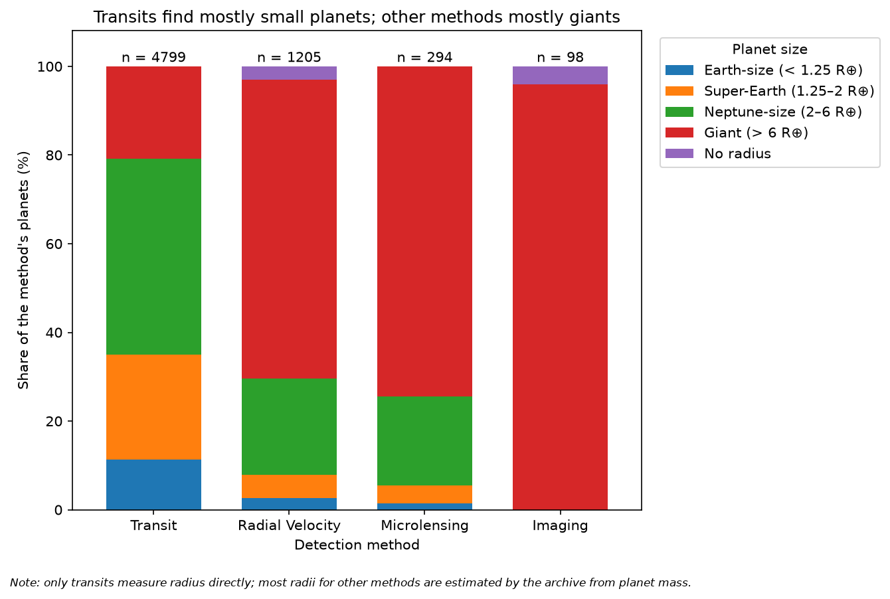
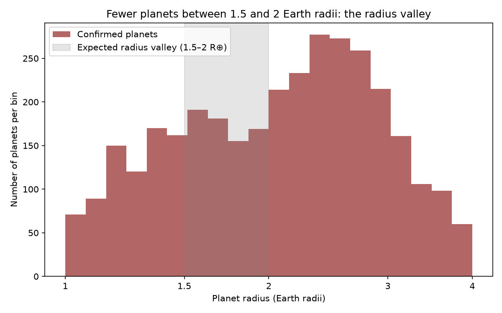

# Exoplanets and Their Host Stars: An SQL Analysis

A PostgreSQL and Python project combining NASA's catalogue of confirmed exoplanets
with the Gaia Catalogue of Nearby Stars to study how exoplanets have been discovered
and which stars host them.

## Description

This project builds a small relational database from two public astronomy catalogues
and uses SQL to answer questions about the known exoplanet population. Planet data
come from the NASA Exoplanet Archive (Planetary Systems Composite Parameters table,
6,470 confirmed planets); stellar data come from the Gaia Catalogue of Nearby Stars
(GCNS; Gaia Collaboration, Smart et al. 2021), 331,312 stars within 100 parsecs of
the Sun. A Python pipeline downloads both catalogues, cleans the data, and loads them
into PostgreSQL, where planets are linked to their host stars through Gaia DR3
source identifiers.

The analysis addresses five key questions:

1. How has the rate of exoplanet discovery changed over time, and which detection
   methods drove it?
2. Do different detection methods find different kinds of planets?
3. Is the "radius valley" (a scarcity of planets between about 1.5 and 2 Earth radii)
   visible in the archive?
4. Do planet-hosting stars differ from typical nearby stars on the Gaia
   colour–magnitude diagram?
5. Which nearby systems host the most known planets?

Key findings include transits account for 74% of all discoveries,
driven by a spike of 1,431 planets in 2016 from Kepler, there is a selection bias with 65% of transit detections being Neptune-sized or giants, and
there is a 'radius of valley' of planets. The project uses joins, common table expressions, window functions,
conditional aggregation and percentile statistics, and compares query performance
with and without indexes using EXPLAIN ANALYZE.

Across all significant detection methods, larger planets with radii ≥ 2 R⊕ are consistently detected more often than smaller planets (< 2 R⊕).

Planets between 1.5 and 2 Earth radii are less common than those just smaller
or larger, consistent with the radius valley reported in the literature.
*Query: [`queries/03_radius_valley.sql`](queries/03_radius_valley.sql)*

**Tools:** PostgreSQL, SQL, Python (pandas, SQLAlchemy, matplotlib), Git.
